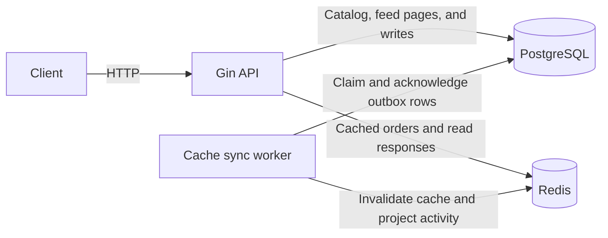

# INO Explore architecture

See the [README](../README.md) for setup, API behavior, and the feed scoring
formula. The [contributor guide](../AGENTS.md) maps the Go packages and lists
the checks to run after a change.

## Runtime components

`cmd/api` wires HTTP handlers to use cases and adapters. The handlers
validate inputs and map responses. Use cases own application rules and define
the persistence interfaces they consume. Domain, use cases, and ranking code
stay independent of Gin, pgx, and Redis.

Compose waits for PostgreSQL to become healthy, runs Goose migrations and the
seed, and then starts the API and worker. The API waits for its own PostgreSQL
ping before listening. Its readiness check queries PostgreSQL with a
one-second deadline. On SIGINT or SIGTERM, the API gives active HTTP requests
up to ten seconds to finish before closing the database pool. The worker
cancels its current batch before closing its clients.

## Data and transaction boundaries

A reel belongs to a creator. The `reel_products` join table associates reels
with products and stores the display position. A composite primary key
enforces uniqueness, and an index on reel ID, position, and product ID
supports deterministic listing. The product query uses a left join so a
published reel with no products can return an empty list.

- Like, Save, and View writes lock the published reel before touching its
  interaction rows. Partial unique indexes enforce one active row per like
  or save kind for each user and reel, and one counted View per UTC date.
  The same transaction
  adjusts the counter by the number of rows inserted or deleted. A counter
  failure rolls back the interaction change.
- Share receipts are unique by sender and idempotency key. After a conflicting
  insert, a new statement at Read Committed reads the winning receipt and
  checks its reel and recipient before replaying it.
- Watch sessions are unique by user and playback ID. The upsert rejects a
  different reel for the same key and uses `GREATEST` to keep cumulative time
  monotonic. Shares and watch reports take a shared reel lock while checking
  publication and accessing the reel.

PostgreSQL triggers create durable activity and enqueue cache work in the same
transaction as the write. A View is counted synchronously. The worker projects
its activity to Redis after commit. Watch sessions create an activity event
on their first crossing of 70%. Ranking reads the stored watch time.

## Feed read path

1. Without a cursor, the API looks up a ranked order by viewer and category in
   Redis. On a miss, it loads the relevant activity and watch signals,
   discovers candidates, and ranks them in Go.
2. PostgreSQL uses partial recency and popularity indexes on published reels.
   It selects candidate IDs before aggregating share and watch facts. Category
   filtering matches linked products and preserves full product lists.
3. The API fetches current reel eligibility, creators, counters, and products
   for each nonempty page in one PostgreSQL query. The query preserves the
   order of the requested IDs and advances past entries that stopped
   qualifying. For continuations, the signed cursor supplies those IDs without
   another ranking calculation or a Redis order lookup.

See the [feed contract](../README.md#feed-ranking-and-pagination) for scoring
and cursor limits and the [benchmark](benchmark.md) for measured tradeoffs.

## Cache invalidation and recovery

Redis caches first-page order, mock identity, product lists, interaction
state, recent activity, and immutable share receipts. Feed order, identity,
products, and recent activity use 15-second TTLs. Interaction state uses
10 seconds, and share receipts use five minutes.

Catalog changes invalidate the shared epoch for feed orders, product lists,
and interaction state. An interaction invalidates the actor's feed-order epoch
across categories. State and identity changes target the relevant keys.
Cache fills compare the entry generation and any applicable epochs before
writing, so an in-flight read cannot restore an invalidated snapshot.

The worker claims up to 16 pending outbox rows with `FOR UPDATE SKIP LOCKED`
inside a five-second transaction. It removes affected cached values and
rebuilds recent activity from the latest durable PostgreSQL events. A guarded
Redis write installs a complete snapshot. Only a successful batch
acknowledges the rows. On failure, the rows remain available for retry.
During an outage or worker lag, writes still commit in PostgreSQL and cached
products or interaction state can reflect the previous publication state until
invalidation or expiry. Feed pages recheck publication in PostgreSQL.

## Capacity bounds

| Resource | Limit |
| --- | --- |
| API PostgreSQL and Redis pools | 10 and 12 connections |
| Worker PostgreSQL and Redis pools | 2 and 2 connections |
| Feed pages and cache fallback reads | 4 concurrent per API process, with up to 16 waiters and a 100 ms admission deadline |
| Admitted PostgreSQL reads and Redis operations | 750 ms for a read, 50 ms default for a Redis operation |

Cache misses for the same key share a load within an API process. Requests
that cannot obtain a PostgreSQL read slot in time return `503`. The worker
polls every 250 ms while idle and waits one second between failed attempts.
